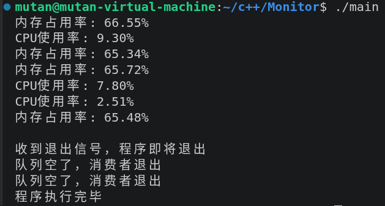
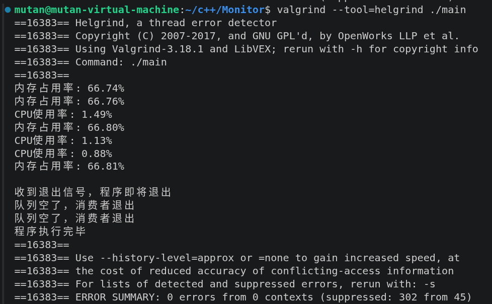
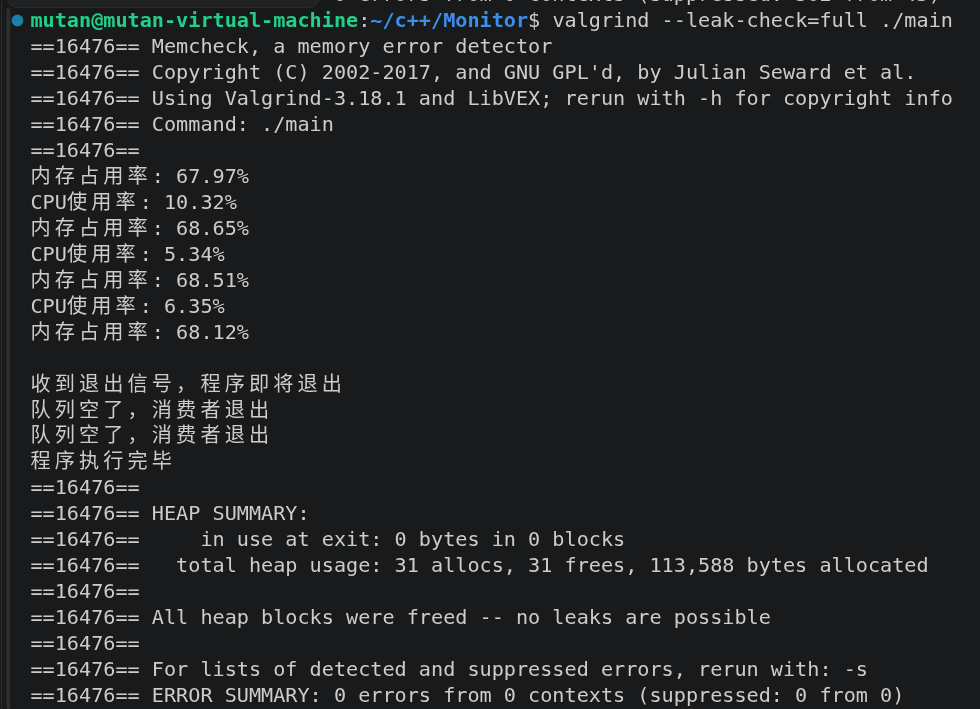

# Linux 多线程资源监视器
基于 C++20 实现的 Linux 主机 CPU、内存采集监视器项目，用于学习 Linux 多线程并发、条件变量、信号优雅退出、线程同步，适配求职项目展示。

## ✨ 功能说明
1. 周期性采集系统 CPU 使用率、内存使用率，生产者-消费者队列模型解耦采集与计算逻辑
2. 双退出通道
   - 交互退出：控制台输入回车 / `q` / `Q`，程序优雅收尾
   - 信号退出：`Ctrl + C` 触发 SIGINT 信号，信号线程捕获信号，通知业务线程退出
3. 线程划分
   - 信号线程：负责接收 SIGINT，设置全局停止标记并唤醒等待的业务线程
   - CPU采集、内存采集生产者线程：读取系统文件采集数据，推入环形队列
   - CPU计算、内存计算消费者线程：取出数据，计算使用率并打印
   - 输入交互线程：读取控制台输入，**采用 detach 简化实现**
4. 打印封装：基于 fmt 库实现线程安全打印 safe_print

## 🧰 技术栈
- C++20，std::thread / std::mutex / std::condition_variable / std::atomic
- fmt 格式化库
- Linux 信号：sigwait / sigtimedwait、信号掩码
- 编译：g++、Makefile
- 校验工具：Valgrind(memcheck)、Helgrind

## 📦 编译运行
```bash
# 编译
make
# 运行
./main

# 两种退出方式
# 1. 输入 q / 回车 正常退出
# 2. Ctrl + C 发送 SIGINT 信号退出


<br>

<br>

